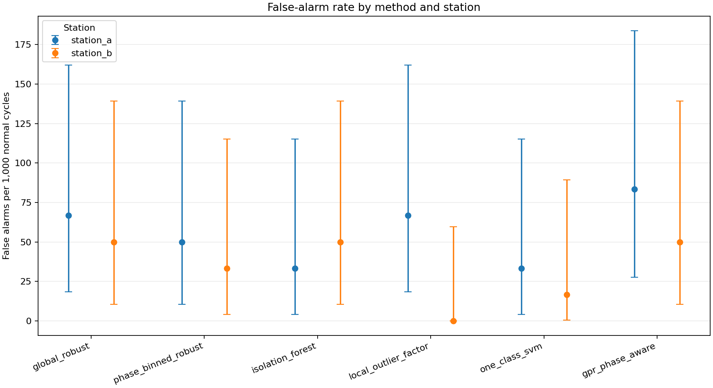
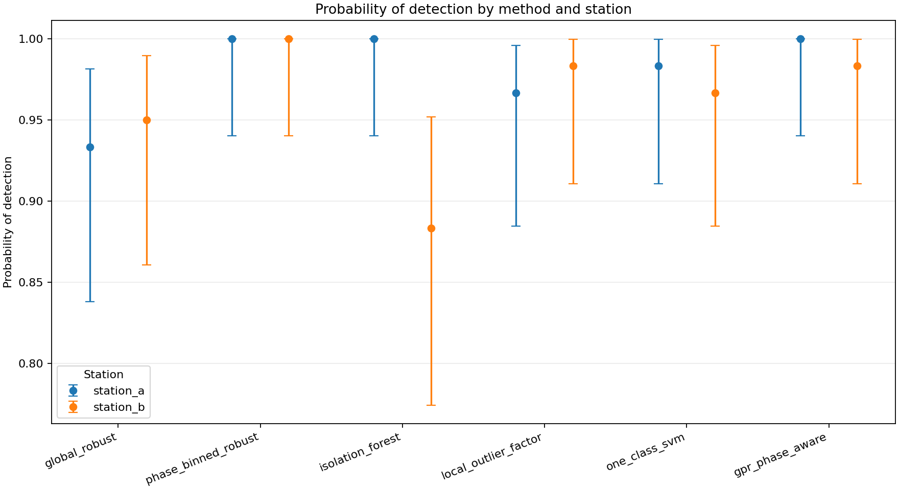
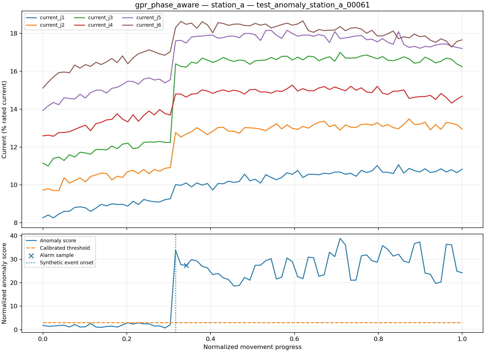

# Synthetic benchmark result (illustrative only)

Version 0.3.0 includes a deterministic six-method comparison using seed `2026` and
exploratory conformal level `alpha=0.05`. Each of two synthetic stations has 60 normal
and 60 anomalous test cycles. Training, scale, calibration, and test cycles are
independent. Each sample is 4 ms apart in this synthetic example.

The complete station-level metrics and confidence intervals are stored in
[`assets/synthetic_benchmark_metrics_by_station.csv`](assets/synthetic_benchmark_metrics_by_station.csv).
The plots below show false-alarm rate (FAR), probability of detection (POD), and one
illustrative GPR current/score trace.

| Method | Station | False alarms / 60 normal | Pre-onset alarms / 60 anomalies | Detected after onset / 60 | POD | Median delay (ms) |
|---|---|---:|---:|---:|---:|---:|
| Global robust | A | 4 | 4 | 56 | 93.3% | 98 |
| Global robust | B | 3 | 3 | 57 | 95.0% | 104 |
| Progress-binned robust | A | 3 | 0 | 60 | 100% | 48 |
| Progress-binned robust | B | 2 | 0 | 60 | 100% | 40 |
| Isolation Forest | A | 2 | 0 | 60 | 100% | 92 |
| Isolation Forest | B | 3 | 5 | 53 | 88.3% | 112 |
| LOF novelty | A | 4 | 2 | 58 | 96.7% | 40 |
| LOF novelty | B | 0 | 1 | 59 | 98.3% | 44 |
| One-Class SVM | A | 2 | 1 | 59 | 98.3% | 52 |
| One-Class SVM | B | 1 | 2 | 58 | 96.7% | 58 |
| Phase-aware GPR | A | 5 | 0 | 60 | 100% | 40 |
| Phase-aware GPR | B | 3 | 1 | 59 | 98.3% | 36 |

Some models raised alarms before the annotated event onset. Those alarms are reported
separately and do not count as successful detections. The FAR confidence intervals are
wide because the example contains only 60 independent normal cycles per station.

This is a software demonstration on artificial signals. It is not evidence of field
performance, physical fault coverage, or safety. The synthetic fault patterns do not
establish equivalence to real mechanical contact or insertion failures.

Reproduce the run with `examples/run_synthetic_demo.ps1` on Windows PowerShell or the
commands in the main README.
